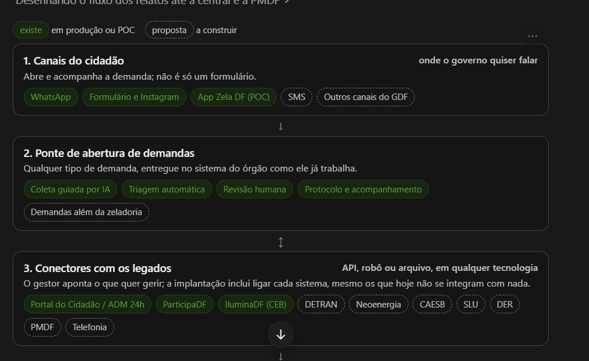
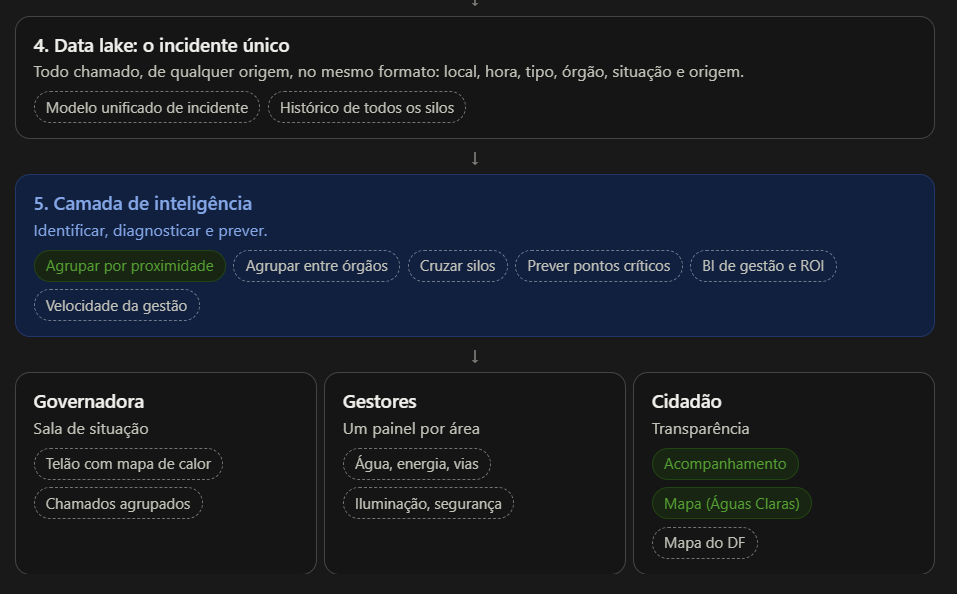
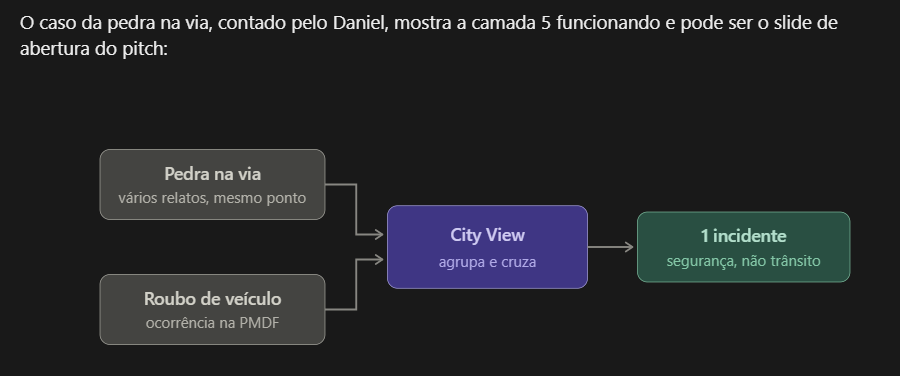

# CV-REF-002 · Rascunho do fluxo e do roteiro (antes da demo exploratória)

| Campo | Valor |
| --- | --- |
| Código | CV-REF-002 |
| O que é | Um rascunho da equipe com três peças: um fluxograma do City View em camadas, o diagrama do caso da pedra na via e um roteiro de pitch em seis passos |
| Quando foi feito | Depois da conversa com o Daniel (10/11/2026) e **antes da demo exploratória** do repositório `City-view` |
| Registrado em | 11/11/2026, a partir de capturas de tela trazidas pela equipe ([imagens](#imagens-originais)) |
| Origem | **[Equipe]**. Nada aqui foi validado com o Daniel |
| Para que serve | Checagem de **completude**: uma lista do que a apresentação e, depois, a demo precisam cobrir. Não é roteiro final nem decisão |

> **Ler com reserva.** O rascunho é anterior à demo exploratória e pode estar
> incompleto. As etiquetas "existe" e "proposta" são as do rascunho; a seção 4
> confere cada "existe" com o que se sabe hoje. Em caso de conflito, vale o
> [Documento Magno](CV-SPEC-000-documento-magno.md).

---

## 1. O fluxo em camadas

Legenda do rascunho: **existe** = em produção ou em POC; **proposta** = a construir.

### Camada 1 · Canais do cidadão

*Onde o governo quiser falar.* Abre e acompanha a demanda; não é só um formulário.

| Item | No rascunho |
| --- | --- |
| WhatsApp | existe |
| Formulário e Instagram | existe |
| App Zela DF (POC) | existe |
| SMS | proposta |
| Outros canais do GDF | proposta |

### Camada 2 · Ponte de abertura de demandas

Qualquer tipo de demanda, entregue no sistema do órgão do jeito que ele já trabalha.

| Item | No rascunho |
| --- | --- |
| Coleta guiada por IA | existe |
| Triagem automática | existe |
| Revisão humana | existe |
| Protocolo e acompanhamento | existe |
| Demandas além da zeladoria | proposta |

Ligação com a camada 3: **nos dois sentidos** (a demanda vai, o status volta).

### Camada 3 · Conectores com os legados

*API, robô ou arquivo, em qualquer tecnologia.* O gestor aponta o que quer gerir;
a implantação inclui ligar cada sistema, mesmo os que hoje não se integram com nada.

| Item | No rascunho |
| --- | --- |
| Portal do Cidadão / ADM 24h | existe |
| ParticipaDF | existe |
| IluminaDF (CEB) | existe |
| DETRAN, Neoenergia, CAESB, SLU, DER, PMDF, Telefonia | proposta |

### Camada 4 · Data lake: o incidente único

Todo chamado, de qualquer origem, no mesmo formato: local, hora, tipo, órgão,
situação e origem.

| Item | No rascunho |
| --- | --- |
| Modelo unificado de incidente | proposta |
| Histórico de todos os silos | proposta |

### Camada 5 · Camada de inteligência

*Identificar, diagnosticar e prever.* Destacada no rascunho como o centro do produto.

| Item | No rascunho |
| --- | --- |
| Agrupar por proximidade | existe |
| Agrupar entre órgãos | proposta |
| Cruzar silos | proposta |
| Prever pontos críticos | proposta |
| BI de gestão e ROI | proposta |
| Velocidade da gestão | proposta |

### As três visões (saídas da camada 5)

| Visão | Para quê | Itens |
| --- | --- | --- |
| **Governadora** | Sala de situação | Telão com mapa de calor (proposta) · Chamados agrupados (proposta) |
| **Gestores** | Um painel por área | Água, energia, vias (proposta) · Iluminação, segurança (proposta) |
| **Cidadão** | Transparência | Acompanhamento (existe) · Mapa de Águas Claras (existe) · Mapa do DF (proposta) |

## 2. O caso da pedra na via

O rascunho propõe este caso, contado pelo Daniel, como **slide de abertura do
pitch**, porque mostra a camada 5 funcionando:

```
Pedra na via            ┐
vários relatos,         ├──►  City View        ──►  1 incidente
mesmo ponto             │     agrupa e cruza        segurança, não trânsito
Roubo de veículo        │
ocorrência na PMDF      ┘
```

## 3. Roteiro sugerido para o pitch aos assessores

Texto do rascunho, sem edição:

1. **O problema.** Cada órgão vê só o próprio pedaço. A comparação do banco lento à tarde, contada pelo Daniel, explica isso rápido.
2. **Exemplos da cidade.** As 50 ligações sobre o mesmo som alto (perturbação do sossego) e a pedra na via que era, na verdade, um problema de segurança.
3. **A solução.** O diagrama acima, com a mensagem de que "nada se substitui, tudo se conecta".
4. **A prova.** Os números de Águas Claras, com fonte e data.
5. **O que a governadora ganha.** A sala de situação, a velocidade da gestão e a transparência para o cidadão.
6. **Implantação em ondas.** ADM 24h, depois DETRAN, Neoenergia, CAESB e PMDF.

---

## 4. Conferência com o que se sabe hoje (11/11/2026)

Cada ponto do rascunho que pede cuidado antes de ir para a apresentação ou para
a demo. Fontes: magno (CV-SPEC-000), histórico (CV-REF-001) e leitura dos
repositórios `dfac-agentic-saas` e `City-view` em 11/11/2026.

### 4.1 Itens marcados como "existe"

| Item | O que se sabe | Cuidado |
| --- | --- | --- |
| WhatsApp | Em produção no dfac desde 30/09/2026 | Nenhum |
| Formulário | Coleta pelo mapa do site parceiro dfaguasclaras.com.br, em produção | É o formulário de um site parceiro, não do GDF |
| Instagram | Código pronto no dfac, mas **travado na verificação da Meta**: só funciona para contas de teste | Não apresentar como canal em uso |
| App Zela DF | POC (07 a 09/11/2026), nunca em produção e nunca mostrado | Dizer "protótipo", não "app" |
| Coleta guiada por IA, revisão humana, protocolo e acompanhamento | Em produção no dfac | Escala de uma região (Águas Claras) |
| Triagem automática | O dfac tem a etapa de triagem no ciclo da demanda | Conferir o que ela faz de fato antes de chamar de "automática" |
| Portal do Cidadão | Envio por sessão compartilhada com login gov.br manual (extensão de navegador); 6 protocolos até 28/10/2026 | Depende de uma pessoa reconectar quando a sessão expira |
| ADM 24h | **Não identificado** (magno, pergunta 9.6). O rascunho o junta ao Portal do Cidadão | Confirmar o que é antes de pôr no slide |
| ParticipaDF | 12 protocolos até 28/10/2026 | Nenhum |
| IluminaDF (CEB) | Implementado no dfac, com envio **desligado** (CONTEXTO_PLATAFORMA, 29/09/2026); nenhum protocolo entre os 18 de 28/10/2026 | Dizer "integração pronta", não "em uso" |
| Agrupar por proximidade | No código do dfac desde 01/10/2026: associação automática a até 30 m e prioridade por recorrência | Não foi conferido se está ligado em produção |
| Acompanhamento e mapa de Águas Claras | Em produção (mapa público do site parceiro) | Os números têm data e período próprios (magno 6.1) |

### 4.2 Outros pontos

- **Implantação em ondas** (ADM 24h → DETRAN, Neoenergia, CAESB, PMDF): é ideia
  da equipe. O magno não define órgãos nem ordem (perguntas 9.13 e 9.14), e o
  `City-view` (D2) recomendava outra ordem (Ouvidoria, CAESB, CEB IPes). O
  **DETRAN** não aparece entre os órgãos citados pelo Daniel (magno 4.8).
- **Pedra na via:** o caso real (Rio de Janeiro, ator baleado) **não foi
  confirmado** (magno, pergunta 9.24), e a equipe decidiu não citá-lo por
  enquanto (magno 5.3). O diagrama supõe dados de ocorrência da PMDF, que hoje
  não existem e dependem de convênio. Como slide de abertura, só como cenário
  ilustrativo, sem nomes.
- **"50 ligações"** sobre o mesmo som: número ilustrativo do Daniel. Os números
  públicos não confirmam que seja a maior fonte de chamados da PM (magno 5.5).
- **"BI de gestão e ROI":** o Daniel falou em BI; ROI é acréscimo da equipe.
- **"Nada se substitui, tudo se conecta":** frase da equipe, coerente com o que
  o Daniel disse ("acoplação e não substituição"; "nós vamos entregar do jeito
  que você está acostumado").
- **O que o rascunho não cobre** e o magno tem: os três graus de transparência
  à escolha da gestão (4.7), o canal escolhido pela gestão (4.3), o cuidado de
  observar a cidade e nunca pessoas (7.6) e a ordem da venda (assessores →
  governadora → equipe, seção 3).

## 5. Como este rascunho entra no trabalho

- **Na apresentação:** as camadas 1 a 5 e as três visões servem de lista de
  completude. Cada uma precisa aparecer no roteiro ou ficar de fora por decisão
  escrita.
- **Na demo:** a coluna "existe/proposta" ajuda a decidir o que mostrar como
  real e o que mostrar como simulado, sempre rotulado.

## Imagens originais






